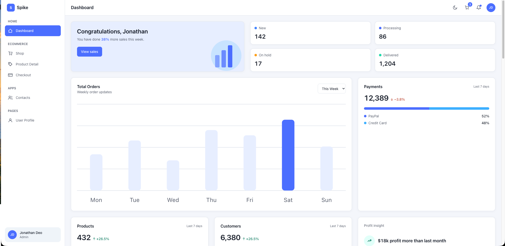

# Spike Admin Dashboard

A light, clean eCommerce admin dashboard in the style of the Spike Nuxt Pro
template. Soft blue primary (`#5D87FF`) on a pale `#F6F8FC` canvas, white
12 px-radius cards with subtle borders, and a dense grid of KPI cards, charts,
tables and review widgets beside a collapsible sidebar.

**Source:** https://spike-nuxtjs-pro-main.netlify.app/dashboards/dashboard1

> Token values in `design.md` are proposed from the rendered page text, not
> measured CSS — check them against a screenshot before relying on exact pixels.

## Contents

- [`design.md`](design.md) — color, typography, spacing, radius and layout
  tokens, plus shared implementation rules.
- [`element/`](element/) — one spec per component, each with anatomy, visual
  specs, states and an HTML/Tailwind blueprint.
- [`example/`](example/) — example pages, plain HTML (Tailwind via CDN) built from those specs. Open
  any of them in a browser; the sidebar links them together and the top bar
  has a light/dark toggle. Each component is marked with
  `data-component="<Name>"` and a comment naming its spec file (or `no spec`).

  | Page | What it shows |
  |---|---|
  | [`index.html`](example/index.html) | Dashboard overview + a gallery of primitives and states |
  | [`profile.html`](example/profile.html) | User profile: cover, stats, tabs (Profile / Followers / Gallery), posts |
  | [`profile-edit.html`](example/profile-edit.html) | Edit profile: photo upload, personal info with validation, notification switches, change password. Saved changes show on the profile page and sidebar |
  | [`customers.html`](example/customers.html) | Customers table with pagination: search, status filter, sortable columns, row selection, rows per page, CSV export |
  | [`contacts.html`](example/contacts.html) | Contacts app: filters, searchable list, detail pane, add-contact dialog |
  | [`ecommerce-shop.html`](example/ecommerce-shop.html) | Product grid with category / price / rating filters, sort, search |
  | [`ecommerce-detail.html`](example/ecommerce-detail.html) | Product detail (`?id=1`–`8`): gallery, colors, quantity, add to cart, reviews |
  | [`ecommerce-checkout.html`](example/ecommerce-checkout.html) | 3-step checkout (Cart, Billing, Payment) with order summary |
  | [`login.html`](example/login.html) | Sign in, laid out like the real [Spike login](https://spike-nuxtjs-pro-main.netlify.app/auth/login): blobs, big card, illustration + form. Demo account, wrong-password alert, forgot-password view |
  | [`register.html`](example/register.html) | Sign up, same layout as login (Name, Email Address, Password). Strength checklist; the new name shows in the shell |

- [`shared.js`](example/shared.js) — loaded by every page: color tokens as CSS
  variables, `tailwind.config`, light/dark theme, mobile drawer, cart, and the
  current user's profile (`[data-profile]` elements).
- [`ecommerce.js`](example/ecommerce.js) — sample product catalog for the three
  eCommerce pages.

> The dark theme and the profile, edit-profile, customers, contacts and
> eCommerce pages are **not** in
> the extracted spec. They are proposed in the same style; their components
> have no file in `element/`.

> **Live-site check (login/register).** The real Spike pages use primary
> `#0085DB`, page background `#F0F5F9` and the font *Plus Jakarta Sans*.
> `design.md` (and every example page) still uses the proposed `#5D87FF`
> and a system font. The login/register layout follows the live site, but
> colors stay on the shared tokens so all pages match.

### Components

| Group | Components |
|---|---|
| Page | [DashboardPage](element/design-dashboard-page.md) |
| Layout | [AppSidebar](element/design-sidebar.md), [AppTopbar](element/design-topbar.md) |
| Dashboard widgets | [DashboardGreetingCard](element/design-dashboard-greeting-card.md), [DashboardWelcomeNotice](element/design-dashboard-welcome-notice.md), [OrderStatusSummary](element/design-order-status-summary.md), [WeeklyOrderUpdatesCard](element/design-weekly-order-updates-card.md), [PaymentsKpiCard](element/design-payments-kpi-card.md), [ProductsKpiCard](element/design-products-kpi-card.md), [CustomersKpiCard](element/design-customers-kpi-card.md), [ProfitInsightCard](element/design-profit-insight-card.md), [LatestDealCard](element/design-latest-deal-card.md), [RecentPurchasersAvatars](element/design-recent-purchasers-avatars.md), [CustomerTrendChart](element/design-customer-trend-chart.md), [RecentProductsTable](element/design-recent-products-table.md), [VisitorLocationCard](element/design-visitor-location-card.md), [LatestReviewsSection](element/design-latest-reviews-section.md) |
| Building blocks | [DashboardCard](element/design-dashboard-card.md), [ChartCard](element/design-chart-card.md), [MetricValue](element/design-metric-value.md), [TrendIndicator](element/design-trend-indicator.md), [StatusBadge](element/design-status-badge.md), [PeriodSelect](element/design-period-select.md), [AvatarGroup](element/design-avatar-group.md), [ProductIdentityCell](element/design-product-identity-cell.md), [CustomerIdentityCell](element/design-customer-identity-cell.md), [RatingDisplay](element/design-rating-display.md), [SearchField](element/design-search-field.md) |
| States | [EmptyState](element/design-empty-state.md), [LoadingSkeleton](element/design-loading-skeleton.md), [ErrorState](element/design-error-state.md) |
| Primitives | [Button](element/design-button.md), [IconButton](element/design-icon-button.md), [DataTable](element/design-table.md), [TextInput](element/design-input.md), [Select](element/design-select.md) |
